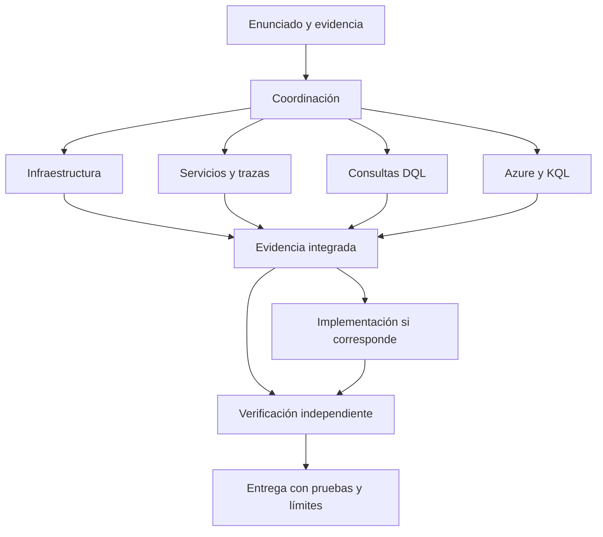

# Equipo multiagente para la hackathon de Copa

Seis perfiles de coordinación y especialidad comparten la skill `copa-observabilidad`; el séptimo perfil, `hackathon_microsoft`, integra Azure y KQL. La base reúne la sesión 1 de Dynatrace, las cápsulas Azure y la Charla 2 de Microsoft, Operación Bajo Presión. Están diseñados para investigar y ejecutar tareas concretas, conservando evidencia entre agentes.

| Agente | Responsabilidad |
| --- | --- |
| `copa_coordinador` | Convierte el enunciado en tareas, elige especialistas e integra la entrega. |
| `copa_infraestructura` | Hosts, Kubernetes, topología y cobertura de instrumentación. |
| `copa_servicios_trazas` | Latencia, fallos, dependencias y causa propuesta. |
| `copa_dql` | Consultas, correlación y agregación de evidencia. |
| `copa_implementador` | Cambios autorizados y pruebas de código/configuración/paneles. |
| `copa_verificador` | Revisión independiente y comprobación del criterio de éxito. |
| `hackathon_microsoft` | Azure Monitor, Application Insights/KQL, App Service y operación bajo presión. |



No es necesario activar todo el equipo. El agente principal coordina; los especialistas no vuelven a delegar. Se respetan los cupos de la sesión y se trabaja por tandas cuando haga falta. El especialista existente `hackathon_microsoft` puede atender componentes Azure cuando estén presentes.

## Uso

Abre la raíz de este proyecto en Codex y utiliza:

```text
Usa $copa-observabilidad y coordina los agentes necesarios para este reto de Copa:
[enunciado]
Evidencias: [archivos o resultados]
Entorno y ventana: [datos conocidos]
Alcance autorizado: [lectura, cambios locales o entorno específico]
Criterio de éxito: [resultado esperado, si está definido]
```

Para preparar la sesión sin un reto:

```text
Usa $copa-observabilidad para explicarme la sesión 1, señalar sus simplificaciones
y preparar un ejercicio simulado de diagnóstico con logs, métricas y trazas.
```

También puedes pedir explícitamente: `Delega a copa_dql la revisión de esta consulta` o `Delega a copa_verificador la revisión de esta solución y sus pruebas`.

Los perfiles siguen el formato de [agentes personalizados de Codex](https://learn.chatgpt.com/docs/agent-configuration/subagents); la skill usa el formato de [skills](https://learn.chatgpt.com/docs/build-skills). Heredan modelo y permisos de la sesión. No se requiere fijar otro modelo ni modificar la configuración global. El descubrimiento debe comprobarse al abrir el proyecto; si la sesión no admite delegación, los roles pueden aplicarse de manera secuencial.

## Base documental y límites

Lee [la síntesis y correcciones](../.agents/skills/copa-observabilidad/references/sesion-1.md), [las plantillas DQL](../.agents/skills/copa-observabilidad/references/dql.md) y [los criterios de validación](../.agents/skills/copa-observabilidad/references/validacion.md).

El documento de Dynatrace tiene 21 páginas. La corrección principal es que PurePath puede aplicar muestreo; también se precisan la cobertura de OneAgent, los conteos DQL y la diferencia entre correlación y causa raíz. La sesión 2 de Dynatrace está anunciada pero no forma parte de esta base. La Charla 2 de Microsoft es otro documento: sus 25 páginas ya están incorporadas en [el análisis](../.agents/skills/hackathon-microsoft/references/charla-2.md) y [el procedimiento operativo](../.agents/skills/hackathon-microsoft/references/operacion-bajo-presion.md).

Estos archivos no instalan OneAgent ni conectan un tenant. Sin acceso real, el equipo entrega análisis y plantillas; con herramientas y autorización pertinentes puede ejecutar comprobaciones. El PDF original no se publica.

## Incidentes del track Microsoft

```text
Usa $copa-observabilidad para coordinar este incidente con el método de Operación Bajo Presión.
Asigna Azure/KQL a hackathon_microsoft, registra hipótesis y pruebas en la bitácora
y valida la funcionalidad real antes de declarar resuelto el problema.
Enunciado, evidencias y alcance autorizado: [datos disponibles].
```

El ciclo es Detectar → Observar → Analizar → Hipótesis → Corregir → Validar. Si la prueba falla, vuelve a observar. Copia la [plantilla de bitácora](../.agents/skills/copa-observabilidad/assets/bitacora-incidente.md) para cada incidente. La plantilla no contiene datos reales.

## Comprobación local

Con Python 3.11 o posterior:

```powershell
python scripts/validate_copa.py
```

El comprobador verifica estructura TOML, referencias locales y metadatos del paquete. No ejecuta DQL, no prueba un despliegue y no garantiza el descubrimiento del perfil por una sesión nueva.

Consulta el [registro de validación](validacion-copa.md) para distinguir las comprobaciones realizadas de las pendientes.
